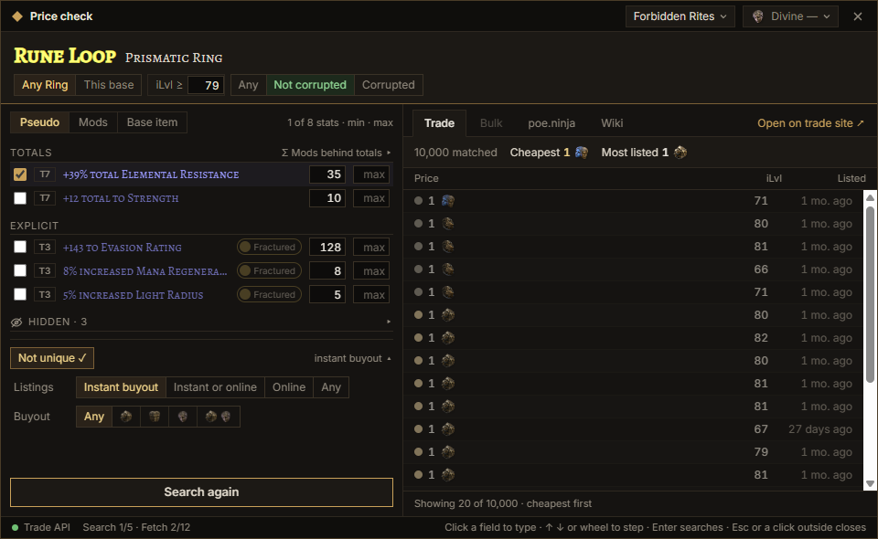
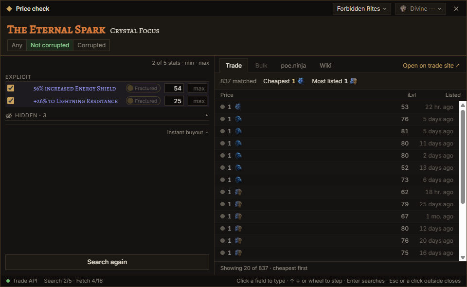
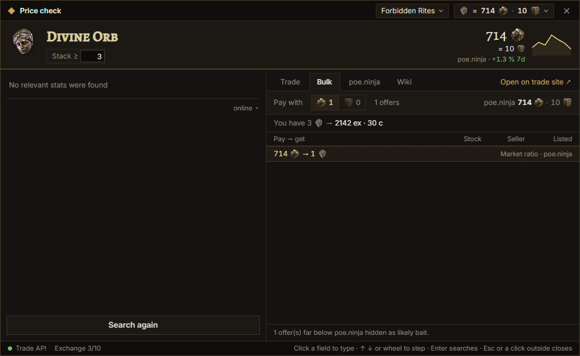
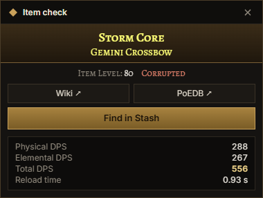
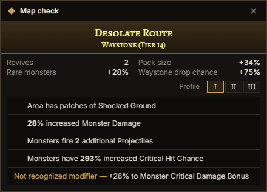
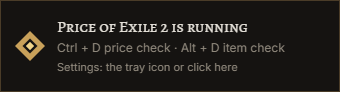
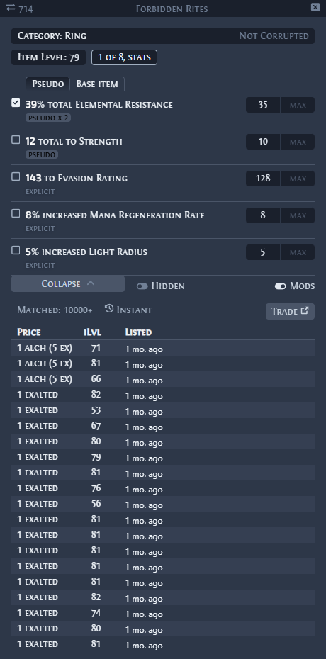

# Price of Exile 2

A Path of Exile 2 price check overlay for Windows: trade listings, poe.ninja prices, bulk exchange,
item and waystone check, stash search presets and chat commands. Downloads:
[Releases](https://github.com/ArtemNA/price-of-exile-2/releases/latest).

Hotkeys: Ctrl + D price check, Alt + D item / waystone check (Settings → Hotkeys). The interface is in
English, Ukrainian and Russian; the English and Russian game clients are supported. The installed
version updates itself (Settings → About).

## Screenshots

A rare item: the base, item level and corrupted switches in the header, pseudo totals and mods with
their tiers, trade listings with currency icons.



A unique: the search starts at once.



Bulk exchange with the poe.ninja price, its 7 day trend and the market ratio; baits are left out.



Item check (DPS, wiki, PoE2DB, Find in Stash) and waystone check with marked mods.

 

The message in the screen corner when the overlay starts:



Two themes ship with the app (ours and Exiled Exchange 2's look, Settings → Overlay → Theme); how to make
your own: [THEMING.md](THEMING.md).



The item parser, trade queries and game data come from
[Exiled Exchange 2](https://github.com/Kvan7/Exiled-Exchange-2) (MIT); see [THIRD_PARTY_LICENSES.md](THIRD_PARTY_LICENSES.md).

This project was generated using [Angular CLI](https://github.com/angular/angular-cli) version 22.2.0.

## Running the app in development

```bash
npm run dev
```

This is `tauri dev` with `src-tauri/tauri.dev.conf.json`: the dev build runs under the identifier
`com.artemna.price-of-exile-2.dev`, so its settings file, WebView data and logs are separate from an
installed release.

Testing without the game: run `scripts/fake-game.ps1` and start the app with `POE_GAME_TITLE="PoE Fake Game"`
(and `POE_KEEP_POPUP=1` for screenshots); see the comments in `scripts/`.

## Releases

Push a tag that matches `version` in `src-tauri/tauri.conf.json` (`git tag v0.1.0 && git push origin v0.1.0`):
`.github/workflows/release.yml` builds the NSIS installer and the portable exe, signs the installer for the
updater and publishes the release with `latest.json`, `SHA256SUMS.txt` and notes from `.github/RELEASE_NOTES.md`
plus the tag's section of `CHANGELOG.md` (write it before tagging). The signing key is the repository secret
`TAURI_SIGNING_PRIVATE_KEY`; its public half is in `tauri.conf.json`. Bump `version` in `tauri.conf.json`,
`Cargo.toml` and `package.json` together.

A local `npx tauri build` signs too and needs the key in the shell; the comments at the top of
`release.yml` show how, or how to build without the signature.

## Building

```bash
ng build
```

The Angular build goes to `dist/`. `npm run build:ee2-default` builds with the Exiled Exchange 2 theme
as the default.

## Running unit tests

```bash
npm test
```

Vitest runs the app's tests and Exiled Exchange 2's parser specs; `cargo test --manifest-path src-tauri/Cargo.toml`
runs the host's.
